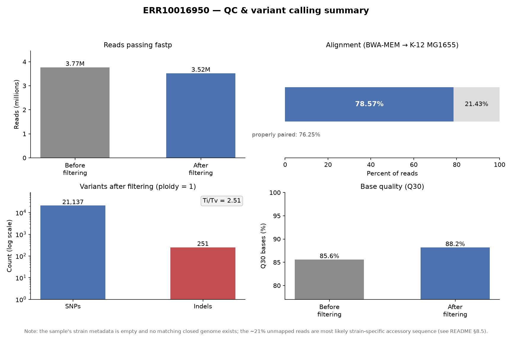

# DNA 重测序变异检测流程

我从 ENA 下载原始测序数据，独立走完
**质控 → 比对 → 排序去重 → 变异检测 → 过滤** 全流程。

> SnpEff 的变异注释（步骤 5）需要先配置 `SNPEFF_DB`（一个几百 MB 的注释库）。
> `config/ecoli.env` 里 `SNPEFF_DB=` 是**留空**的，所以脚本会打印启用说明后自动跳过（`exit 0`），
> 仓库里因此没有 `vcf/<run>.ann.vcf`。第 9 节的组装与基因内容注释是另一条独立分析路径。

和另一个 RNA-seq 项目（暂未纳入本仓库）互补：
那条线练的是表达量分析，这条线练的是 **BWA + samtools + bcftools** 这套 DNA 变异检测工具链。

---

## 1. 数据（已核实）

### 数据：大肠杆菌 WGS

| 项目 | 值 |
|---|---|
| ENA run | **ERR10016950** |
| BioSample | `SAMEA9333667`（二级号 `ERS7066877`） |
| 所属 study | **PRJEB8667** — *Pathogenic lineages of enteric bacteria in Nigeria*（Sanger Institute） |
| 物种 / 类型 | *Escherichia coli* / WGS，双端 |
| 测序平台 | Illumina HiSeq X Ten，151 bp |
| 数据量 | **3,769,474 reads（1,884,737 对）**，双端 151 bp；实测文件 113 + 142 MB |
| 覆盖度 | 约 **123×**（569 Mb 碱基 / 4.64 Mb 基因组） |
| 参考基因组 | E. coli K-12 MG1655，**GCF_000005845.2**（1.3 MB） |
| 端到端耗时 | **20–30 分钟** |

> ⚠️ **数据集局限（重要）**
>
> 该 BioSample 的 `strain`、`serotype`、`sample_description` **全部为空**，
> 也没有关联的已组装基因组。study 层面描述为
> **肠聚集性大肠杆菌（EAEC）**，但**无法确定到具体菌株**；
> 而且第 9 节的基因内容分析**并未检出 EAEC 的定义性基因**（`aggR` / `aafA` / `astA`），
> 这个标签是否适用于本 isolate 存疑，详见 [9.4 节](#94-毒力谱核心毒力因子未见-eaec-特征)。
>
> 因此本项目的定位是「**验证流程能否跑通**」，**不是**「变异检测基准」：
> 它没有 truth set，无法判断检出的 21,137 个 SNP 里有多少是正确的。
> 若需要可量化的验证，应换用「元数据完整 + 有配套完整基因组」的数据集。
>
> 详细核查过程见 [第 8.6 节](#86-数据溯源核查)。

相关页面：
[ENA run](https://www.ebi.ac.uk/ena/browser/view/ERR10016950) ·
[study](https://www.ebi.ac.uk/ena/browser/view/PRJEB8667) ·
[sample](https://www.ebi.ac.uk/ena/browser/view/SAMEA9333667)

```bash
CONFIG=config/ecoli.env bash scripts/run_all.sh
```

下载链接来自 ENA 官方 API 返回的 `fastq_ftp` 字段，已核对为双端配对的两个文件。

---

## 2. 参考基因组（已查证）

| 文件 | 大小 |
|---|---|
| `https://ftp.ncbi.nlm.nih.gov/genomes/all/GCF/000/005/845/GCF_000005845.2_ASM584v2/GCF_000005845.2_ASM584v2_genomic.fna.gz` | 1.3 MB |

参考基因组取自 NCBI RefSeq（E. coli K-12 MG1655，GCF_000005845.2）。
路径写在 `config/ecoli.env` 里，脚本检测到文件不存在会自动下载。

---

## 3. 环境

```bash
wsl -d Ubuntu
cd /path/to/bioinformatics-practices/DNAseq/01-ecoli-ERR10016950     # 换成自己的实际路径
conda env create -f envs/dna.yaml
conda activate dna
```

**资源预算**（大肠杆菌 WGS）

| 项目 | 需求 |
|---|---|
| 磁盘 | 约 **1.2 GB**（fastq 0.26 + clean 0.24 + BAM 0.26 + assembly 0.18 + 抽样与日志 0.14 + ref 0.04 + qc 0.05 GB） |
| 内存 | 2 GB 足够（bwa index 与比对） |
| 时间 | 全流程 20–30 分钟（下载数分钟、比对约 10 分钟、变异检测数分钟） |

---

## 4. 流程

| 步骤 | 工具 | 产出 |
|---|---|---|
| 1 下载 | aria2 / wget | `fastq/*.fastq.gz` |
| 2 质控 | fastp + FastQC + MultiQC | `qc/multiqc/multiqc_report.html` |
| 3 比对去重 | **bwa mem** → samtools | `bam/<run>.markdup.bam` |
| 4 变异检测 | bcftools mpileup/call/norm/filter | `vcf/<run>.filtered.vcf.gz` |
| 5 注释（可选） | SnpEff | `vcf/<run>.ann.vcf`（**未随仓库提供，需自行运行**） |
| 6 参考筛选（诊断，可选） | bwa mem + samtools flagstat | `qc/refcheck/reference_screening.tsv`（**未随仓库提供，需自行运行**） |
| 7 汇总图（可选） | matplotlib | `qc/summary/<run>.summary.png` |
| 8 基因内容（附加） | SPAdes + abricate | `results/gene_content/summary.tsv` |

### 为什么顺序必须是「名字排序 → fixmate → 坐标排序 → markdup」

`samtools markdup` 需要 mate 的坐标信息才能判断一对 reads 是否重复，
所以流程是：

```
bwa mem → samtools sort -n（按名字排序，让 mate 相邻）
        → samtools fixmate -m（补齐 mate 标签、MC/ms 标记）
        → samtools sort（按坐标排序）
        → samtools markdup（标记重复）
```

漏掉 `fixmate` 直接 markdup，samtools 会直接报错。

### 三个关键概念

**① 为什么 DNA 要去重，而 RNA-seq 不用？**
PCR 扩增产生的重复片段会被误判成「支持变异的证据」，造成假阳性，所以 DNA 必须去重。
RNA-seq 的重复主要来自高表达基因，是真实信号，去重反而有害。

**② 为什么 `bcftools norm -f ref -m -both`？**
不同工具对 indel 的表示方式不同（同一位点可能写成 `AT>A` 或 `A>-`），
`norm` 做**左对齐（left-align）**并拆分多等位基因，保证结果可与其他工具/数据库比较。

**③ Ti/Tv 比值是什么？**
转换（A↔G、C↔T）与颠换的比值。在样本与参考高度一致的数据里，真实变异通常在 **2.0 以上**；
只有 1.2 左右往往意味着假阳性偏多，因此常被当作质控参考。`04_call.sh` 会自动打印。

> ⚠️ **适用边界**：Ti/Tv 作为 QC 指标只在「样本与参考足够接近」时成立。
> 本项目是"致病分离株 vs 实验室 K-12"，SNP 集本质是谱系分歧，Ti/Tv 反映突变谱而非错误率，
> **不能据此判断流程好坏**。详见第 8.5 节。

---

## 5. 跑完怎么自检

| 检查项 | 参考值 / 判读 |
|---|---|
| 比对率（flagstat `mapped`） | 同种参考通常 >95%；本数据集实测 **78.57%**，原因见第 8.5 节 |
| 重复率（markdup 报告） | 一般 5%–20%；本数据集实测 **5.7%** |
| 变异数量 | 与 MG1655 参考不同的分离株会有几千到几万个变异，属正常；本数据集实测 **21,137 SNP + 251 indel** |
| Ti/Tv | 细菌无公认基准，**不建议作为判断依据**（见第 8.5 节） |

`04_call.sh` 跑完会把 SNP 数、indel 数、Ti/Tv 直接打在屏幕上；本项目把这些数字连同运行环境与参数一并记录，便于复现和横向对比。

---

## 6. 输出与目录

```
01-ecoli-ERR10016950/
├── README.md
├── config/          ecoli.env   ← 换数据集只改这里
├── samples/         样本表（含 ENA 直链）
├── envs/dna.yaml
├── scripts/         lib.sh + 01~08 + run_all.sh
├── fastq/ clean/ bam/ ref/     中间文件（.gitignore 已排除）
├── assembly/        SPAdes 组装结果（.gitignore 已排除）
├── qc/              MultiQC 报告 + summary/（汇总图）+ refcheck/（参考筛选，需自行运行）
├── results/gene_content/  毒力 / 耐药 / 质粒注释表（入库）
└── vcf/             raw / norm / filtered VCF + stats
```

> **生成汇总图**（只读已有结果，不重跑流程）：
>
> ```bash
> conda activate dna             # 本环境的 matplotlib 需先装上（见下）
> python scripts/07_summary_plot.py
> ```
>
> 如果报 `ModuleNotFoundError: matplotlib`，说明环境是在加这条依赖之前建的，补装即可：
>
> ```bash
> conda env update -f envs/dna.yaml
> ```
>
> 输出 `qc/summary/<run>.summary.png`：reads 过滤前后、比对率、变异数、Q30 四联图。

### 结果概览



四格依次为：reads 过滤前后（3.77M → 3.52M）、比对率（78.57%，其中 properly paired 76.25%）、
变异数（21,137 SNP / 251 indel，对数轴）、Q30 碱基比例（85.6% → 88.2%）。
图中"21.43% 未比对"的成因见 [第 8.5 节](#85-两个异常的归因)。

入库内容：`scripts/`、`config/`、`samples/`、`envs/`、`README.md`、
`vcf/*.vcf.gz`（约 2 MB）、`vcf/*.stats.txt`、`qc/` 下的报告与汇总图，
以及 `results/gene_content/`（毒力 / 耐药 / 质粒注释表，约 68 KB）。

不入库：BAM、fastq、参考基因组及其索引、`assembly/`（SPAdes 中间产物）—— 均在 `.gitignore` 里。

---

## 7. 这套流程的边界与已知取舍

- **单样本**：真实项目里多样本会做 joint calling（GATK GenomicsDBImport 或 `bcftools merge`），
  而不是各自调用再合并。
- **没有 BED 时是全基因组调用**：targeted（外显子组 / panel）数据因为只有目标区有 reads，
  结果基本等价，但会慢不少。生产流程一定用试剂盒对应的 target BED。
- **没有做 BQSR / 变异质控建模**：GATK 最佳实践里有，bcftools 流程通常省略。
- **没做 CNV / SV**：那是另一套工具（CNVkit、Manta、Delly）。
- **样本不纯**：本数据混有 *K. pneumoniae*，按 reads 计约 **16–20%**（按组装 contig 长度计约 47%），
  所以比对率、变异集与基因注释都不能按"单一菌株"来解读。见 [9.2 节](#92-组装后的意外发现样本不纯)。

---

## 8. 已知限制与排查记录（2026-10 大肠杆菌自测）

用 ERR10016950 完整跑通全流程后的**实测结果**，以及排查过程中发现的两个 bug。
数字全部来自实际运行，限制如实写出。

### 8.1 实测结果

| 指标 | 实测值 |
|---|---|
| 原始 reads | **3,769,474**（1,884,737 对，双端 151 bp） |
| fastp 后通过过滤 | 3,524,108 条（丢弃 **6.5%**；Q30 从 85.58% 升到 88.18%） |
| 比对率（flagstat `mapped`） | **78.57%** |
| 重复率（flagstat `duplicates`） | 202,648 / 3,524,108 ≈ **5.7%** |
| 最终 SNP | **21,137** |
| 最终 indel | **251** |
| Ti/Tv | **2.51** |

> **一个容易读错的字段**：ENA 的 `read_count = 3,769,474` 统计的是**双端 reads 总数**，
> 不是 read pairs —— 实际是 1,884,737 对。
>
> 验证：`base_count = 569,190,574 = 1,884,737 × 151 bp × 2`，与文件实测完全吻合。
> 按这个数算出的覆盖度是 **123×**，不是 245×。

### 8.2 已修复的 bug ①：`bcftools call` 缺少 `--ploidy 1`

初版命令是 `bcftools call -mv`，即使用**默认的二倍体模型**。大肠杆菌是单倍体，后果很大：

| | 修复前（ploidy=2） | 修复后（ploidy=1） |
|---|---|---|
| SNP | 84,425 | **21,137** |
| indel | 338 | 251 |
| 基因型 | 出现 `0/1` 杂合 | 全部为单倍体基因型 `1` |

> 单倍体 VCF 的 GT 是**单个数字** `1`，不是二倍体纯合的 `1/1`。
> 实测两个 VCF 的全部记录：raw 23,835 条、filtered 21,388 条，GT 均为 `1`。
> 反过来说，**如果看到 `1/1`，就说明调用时仍然用了二倍体模型**。

> **数字口径说明**：84,425 / 338 是**修复前（ploidy=2）**那次运行的历史数字，
> 当时的 VCF 已被覆盖，**无法从本仓库复现**；仓库里保留的是 ploidy=1 的最终结果
> （21,137 SNP / 251 indel）。第 8.4 节的过滤前后对比统一采用 ploidy=1 的数（266 → 251）。

**84,425 个 SNP 里有约 6.3 万个是二倍体模型造出来的假阳性**——单倍体基因组不可能有杂合位点。
`bcftools call --help` 里 `--ploidy` 的默认值明确写着 `[2]`，所以这个参数必须显式指定。

现已把倍性做成配置项，避免二倍体物种与细菌（单倍体）互相污染：

- `scripts/lib.sh`：`PLOIDY="${PLOIDY:-2}"`（默认二倍体），并 export
- `config/ecoli.env`：显式设 `PLOIDY=1`
- `scripts/04_call.sh`：`bcftools call -mv --ploidy "$PLOIDY"`

### 8.3 已修复的 bug ②：`fastqc -o` 在新版本上失效

FastQC 0.12+ 的输出目录参数只接受 `--outdir`，`-o` 会直接报
`fastqc: error: unrecognized arguments: -o`。因为脚本开头有 `set -e`，
这个报错会让整个流程停在第 2 步末尾（MultiQC 也一并没跑）。

已把两个项目的 `02_qc.sh` 统一改成 `--outdir`。

> 这类"老参数在新版本静默失效"的问题不容易第一时间发现：`envs/dna.yaml` 没有固定版本，
> 每次 `conda env create` 都可能换上更新的工具。

### 8.4 一个已排除的"疑似问题"：indel 是不是丢了？

21,137 个 SNP 只配 251 个 indel（约 84:1），乍看像 indel 检出失败。
排查后得到一个**有边界的结论**：**调用阶段没有丢 indel，但"样本本身 indel 就少"仍未定论**（见下）。

**直接证据：用 CIGAR 统计（独立于变异调用器）**

```bash
samtools view bam/ERR10016950.markdup.bam | head -200000 | cut -f6 \
  | awk '/[ID]/{n++} END{printf "%d / %d = %.1f%%\n", n, NR, n/NR*100}'
# 输出：2091 / 200000 = 1.0%
```

推算：277 万条 mapped reads × 1.0% ≈ 2.78 万条跨 indel 的比对；按约 90× 覆盖度，
每个 indel 位点被约 90 条 reads 覆盖 → **约 300 个 indel 位点**，与实测 251 个相差不大。

**这条证据能证明什么、不能证明什么（重要，别说过头）：**

- ✅ **能证明**：比对器已经表示成 `I`/`D` 的 indel，调用器一个没丢——
  CIGAR 是 bcftools 之前就定下来的，不受任何调用参数影响。
- ❌ **不能证明**：样本本身的 indel 就少。如果 bwa 把 indel 用**错配**或 **soft clip**
  糊过去（短 indel 落在重复序列里时很常见），CIGAR 里就不会出现 `I`/`D`，
  这套统计对此是**盲的**。

所以准确的结论是：**"调用阶段没丢"成立；"比对阶段没藏、样本本身 indel 就少"仍未定论。**

**若要继续区分**，可看 soft clip 比例（若异常高，说明比对器把序列切掉而不是用 gap 表示）：

```bash
samtools view bam/ERR10016950.markdup.bam | head -200000 | cut -f6 \
  | awk '/S/{s++} /[ID]/{n++} END{printf "含S: %d (%.1f%%)  含I/D: %d (%.1f%%)\n", s, s/NR*100, n, n/NR*100}'
```

**同时排除了另外三个假设**：

| 假设 | 验证方法 | 结果 |
|---|---|---|
| 被 `bcftools filter` 砍掉 | 对比过滤前后（ploidy=1 的正式结果） | 过滤前 **266** → 过滤后 **251**，只少了 15 个，**不是 filter 造成的** |
| 重复序列区误比对 | 按 MQ 阈值过滤 | MQ≥60 时 21,137 个 SNP 仍剩 16,105 个，**不是假象** |
| 先验突变率过低 | `-P` 从 1.1e-3 提到 5e-2 | indel 总数基本不变，**纹丝不动** |

> 复盘（两处判断失误）：
> 1. 最初判断"84:1 异常"，依据是"细菌 SNP:indel 约 5–15:1"这个**未经核实的经验比例**——
>    这个判断本身不严谨。观测比例 = **真实比例 × 检出效率差**，SNP 和 indel 的检出难度
>    根本不同，光看比例判断不了对错。
> 2. 后来用 CIGAR 做直接测量，方向是对的，但**结论一度说强了**：它排除了"调用阶段丢失"，
>    没有排除"比对阶段隐藏"。

### 8.5 两个异常的归因

**① 比对率 78.57% —— 两个成因：参考株不匹配 + 样本混入克雷伯菌**

最初归因于"数据质量/纯度问题"，后来我一度判定**这个归因是错的**。
但查完组装数据后，这个判断本身也不准确——**那个初始猜测只对了一半**。

核查 ENA 元数据后，确实找到了更主要的原因：

- 该 run 所属 study 为 **PRJEB8667 — "Pathogenic lineages of enteric bacteria in Nigeria"**，
  研究描述明确写的是 *non-typhoidal Salmonella and **enteroaggregative E. coli*** ——
  样本属于 **EAEC（肠聚集性大肠杆菌）**，是临床/致病分离株，不是实验室驯化的 K-12。
- *E. coli* 泛基因组差异极大（不同菌株间可有 1–2 Mb 特有序列）。EAEC 常携带
  pAA 质粒、AAF 黏附素、EAST-1 毒素等序列，**这些在 K-12 参考里根本不存在，当然比对不上**。
  这属于生物学差异，不是数据缺陷。

验证脚本：`scripts/06_reference_check.sh` —— 用**同一份 reads** 比对 6 个代表性
*E. coli* 完整基因组，并额外比对一个"6 株合并参考"。

**原设想的判据**是「合并参考的比对率接近 99% 即可确认未比对部分属于菌株特有序列」。
但组装发现样本混入 *K. pneumoniae* 后（[9.2 节](#92-组装后的意外发现样本不纯)：GC 57.3%、
BLAST 一致性 99.96%），这个判据不再成立：理论上限变成 **约 80–84%**
（= 100% − 约 16–20% 的 *K. pneumoniae* reads），永远到不了 99%。

**但这个上限反而让现有数字变得有用了。** 实测 78.57% 距上限只差 **约 1.4–5.4 个百分点**，
折算成序列约 **0.1–0.3 Mb** —— 与一株非 O157 型 *E. coli* 的 accessory genome 量级相符。

也就是说，**78.57% 这个数字本身已经间接支持了「参考株不匹配」这一成因**，不必等脚本跑完。
剩下没解决的是：把这 ~5 个百分点**定量拆成**「菌株特有序列」与「其他原因」——
这一步仍然需要 `06_reference_check.sh` 的直接实测。

> 本仓库**未附该验证的结果表**（脚本需从 NCBI 下载约 9 MB 参考基因组，
> 国内网络条件下可能较慢）。上面的结论是**基于元数据的推断**，脚本保留在仓库里，可自行实测。

**② Ti/Tv = 2.51 —— 这个指标在本场景下本来就不该当 QC 用**

Ti/Tv 的常用预期区间（约 2.0–2.1）是针对**"与参考高度一致的样本"**建立的。
本项目的 SNP 集是"致病分离株 vs 实验室 K-12"，本质是**谱系分歧**，反映突变谱而非测序错误率。
所以"细菌应约 1.0"这个预期本来就没有依据（当时也未找到出处）。

**结论修订**：78.57% 可解释，成因有**两个**——参考株不匹配，以及样本混入 *K. pneumoniae*。

最初"数据质量/纯度问题"的猜测**方向是对的**，但当时只是猜测、没有证据。
现在两个成因的**证据强度并不相同**：

| 成因 | 依据 | 强度 |
|---|---|---|
| 样本混入 *K. pneumoniae* | 覆盖度双峰 + GC 分离 + BLAST 一致性 99.96% | **证实** |
| 参考株不匹配（accessory genome） | ENA 元数据的 study 描述 | **强推断**：`06_reference_check.sh` 未附结果表，且原定判据（合并参考应达 ~99%）因混入物种而失效 |

所以这一节只能写"成因**分成两条**"，不能写"都已定位"。

通用原则：**遇到数字异常，先查元数据，再怀疑数据质量，最后用组装 / 分类学验证。**

> 第 9 节组装后发现，组装总长 10.83 Mb 中约 **5.1 Mb（47%）**属于另一个 GC 57.3% 的物种。
>
> **两个口径不要混**：47% 是按**组装出的 contig 长度**算的；按 **reads** 算只有约 **16–20%**
> —— 因为那株菌的覆盖度只有 *E. coli* 的 1/3 左右，所以它占的长度份额远大于测序数据份额。
>
> 因此那 21% 未比对的 reads 是「菌株特有序列 + 混入的 *K. pneumoniae*」之和，
> 并非单纯由 accessory genome 造成。详见 [9.2 节](#92-组装后的意外发现样本不纯)。

### 8.6 数据溯源核查

用 ENA 官方 API 拉取样本 XML 后的完整结果（2026-10 核查）：

| 字段 | 值 |
|---|---|
| BioSample | `SAMEA9333667`（二级号 `ERS7066877`） |
| 提交者内部 ID | `3534STDY10261424`（Sanger 测序批次号，**不是菌株名**） |
| 物种 | *Escherichia coli*（taxid 562） |
| `strain` | **空** |
| `serotype` / `isolate` / `sample_description` | **空** |
| 关联的已组装基因组 | **无**（仅提供 FASTQ 链接） |

**含义：该样本无法从公开记录确定到菌株级别。** 若要判断谱系，只能从 reads 计算
（7 基因 Achtman MLST，或 8 基因 Pasteur 方案定 phylogroup）。

**因此本数据集的适用范围是「流程连通性验证」，不是「变异检测基准」**：
没有 truth set，就无法判断 21,137 个 SNP 中有多少是真的。

**结论**：这条流程的逻辑与实现是通的——1–4 步完整跑通并产出 VCF，
第 5 步（注释）因未配置注释库而按设计跳过，参数整体可切换数据集。

数据侧的保留意见有**两条**：**没有基准真值**，以及**样本不是单一菌株**
（混入约 16–20% 的 *K. pneumoniae*，见第 9 节）。若要升级为可量化验证，
应换用「元数据完整 + 有配套完整基因组 + 纯培养」的样本，这样比对率与变异集才有明确的判读标准。

> **这轮的结论**：选数据前先确认「元数据完整 + 有配套完整基因组」。
> 元数据的 `strain` 字段是否为空，一条 ENA API 请求两分钟就能查到——这次是事后才查的。

---

## 9. 附加分析：基因内容（毒力 / 耐药 / 质粒）

**为什么另起一条分析，而不是用第 4 步的 SNP 结果？**

本样本来自「尼日利亚肠道致病菌」研究。它的耐药基因与可能的毒力因子大多位于 accessory genome
（质粒、毒力岛），这些序列在 K-12 MG1655 参考里不存在，靠 SNP 路径拿不到。

另外，本数据**混有 *K. pneumoniae***（按 reads 计约 16–20%，[9.2 节](#92-组装后的意外发现样本不纯)），
所以注释结果必须按 contig 归因，不能整体算给 E. coli。

| 想问的问题 | 该用什么方法 |
|---|---|
| 这个菌**携带哪些毒力 / 耐药基因** | 基因内容注释（本节） |
| 它和 K-12 差多少 | SNP 比对（第 4 步）；那是**谱系距离**，不是致病性信号 |
| 它属于哪个克隆群 | MLST / phylogroup（可另做） |

### 9.1 流程

抽 50× reads → SPAdes 组装 → 按覆盖度过滤 → abricate 比对四个库

```bash
conda env update -f envs/dna.yaml                       # 一次性：装上 spades + abricate
CONFIG=config/ecoli.env bash scripts/08_gene_content.sh
```

| 数据库 | 查什么 |
|---|---|
| `vfdb` | 毒力因子（黏附素、毒素、分泌系统等） |
| `card` | 耐药基因（综合库） |
| `resfinder` | 耐药基因（侧重水平转移，临床常用） |
| `plasmidfinder` | 质粒复制子 |

**产出**：`assembly/spades/contigs.fasta`（全部组装）、`contigs.filtered.fasta`（过滤后）、
`results/gene_content/{vfdb,card,resfinder,plasmidfinder}.tsv`，以及汇总表
`results/gene_content/summary.tsv`（覆盖度 ≥80% 且一致性 ≥90%）。

### 9.2 组装后的意外发现：样本不纯

我对组装结果按 contig 覆盖度做了直方图，看到**两个清晰的峰**：

| 覆盖度 | contig 数 | 总长 | 加权 GC |
|---|---|---|---|
| 2–4× | 332 | 5.01 Mb | **57.3%** |
| 4–8× | 1375 | 0.77 Mb | 52.3% |
| 8–12× | 942 | 1.01 Mb | 49.5% |
| 12–20× | 1394 | 3.74 Mb | 51.1% |
| 20–40× | 168 | 0.19 Mb | 52.1% |

*E. coli* 的 GC 是 50.5%，而 2–4× 那一组是 **57.3%、总量约 5 Mb** —— 这不是 E. coli，
是**一个完整的第二基因组**。把 contigs 比回 K-12 也印证了这一点：
4421 条里有 356 条比对不上，与高 GC 组的 332 条基本吻合。

因此按覆盖度 ≥4× 过滤（脚本里的 `MIN_COV`，默认 4）：

| | contig 数 | 总长 | 加权 GC |
|---|---|---|---|
| 保留（E. coli） | 3952 | 5.72 Mb | **51.0%** |
| 丢弃（低覆盖度，主要为 *K. pneumoniae*） | 469 | 5.11 Mb | **57.2%** |

> **物种已确认（NCBI BLAST）**
>
> | 项目 | 值 |
> |---|---|
> | 查询序列 | `NODE_1` 的前 5,000 bp（该 contig 全长 242,614 bp、覆盖度 3.96×、GC 58.0%） |
> | 程序 / 数据库 | megablast / `core_nt` |
> | 结果 | **前 100 条命中全部为 *Klebsiella pneumoniae*** |
> | 一致性 / Query Cover / E 值 | **99.96% / 100% / 0.0** |
> | 查询日期 | 2026-10-19（RID `DCC185VW014`，NCBI 仅保留约 24 小时） |
>
> *K. pneumoniae* 基因组约 5.4 Mb、GC 57.5%，与上面测到的 4.6 Mb / 57.3% 吻合。
> 之前几条旁证（`IncFIB(K)` 复制子、CARD 里的 `Klebsiella_pneumoniae_acrA` / `OmpK37`）由此闭环。
> **复现方式**：从 `assembly/spades/contigs.fasta` 取 `NODE_1` 前 5 kb，用 megablast 比对 `core_nt` 即可。

### 9.3 耐药基因：检出 MDR 相关基因，但归属存疑

`resfinder` 有 9 个获得性耐药基因通过阈值（一致性 99–100%）：

| 基因 | 药物类别 | 所在 contig | 该 contig 的 GC / 覆盖度 |
|---|---|---|---|
| `blaTEM-1B` | β-内酰胺 | `NODE_336` | 50.2% / 9.7× |
| `QnrS1`、`tet(A)` | 喹诺酮、四环素 | `NODE_273` | 55.0% / 14.1× |
| `sul2`、`strA/B`、`dfrA14` | 磺胺、氨基糖苷、甲氧苄啶 | `NODE_440` | 54.5% / 10.8× |
| `sul1`、`aadA1`、`dfrA1` | 磺胺、氨基糖苷、甲氧苄啶 | `NODE_103` | **58.4% / 4.4×** |

**我没有直接写成「该 E. coli 是 MDR」**，原因有三：

- 这些基因分散在多个 5–20 kb 的短 contig 上，contig 之间没有重叠，
  **无法证明它们与质粒复制子共定位**——复制子分别落在 `NODE_262` / `NODE_401` / `NODE_393` 等另外几条 contig 上。
- 携带 `sul1 + dfrA1 + aadA1`（class 1 整合子典型盒式）的 `NODE_103`，
  **GC 58.4%、覆盖度仅 4.4×**，与已确认的 *K. pneumoniae*（GC 57.5%）高度吻合——
  **这组基因基本可以判定属于克雷伯菌，而不是目标 E. coli**。
- 只有 `blaTEM-1B` 所在的 `NODE_336`（GC 50.2%、覆盖度 9.7×）与 *E. coli* 一致，
  归属相对可靠；`NODE_273`（55.0%）与 `NODE_440`（54.5%）处于两者之间，无法判归。

结论：**"样本中存在多种获得性耐药基因"属实；但属于 E. coli 的只有 `blaTEM-1B` 较为可靠，
`NODE_103` 那一组应归给 *K. pneumoniae*。** 因此本文档**不对 E. coli 的耐药表型下结论**。

### 9.4 毒力谱：核心毒力因子，未见 EAEC 特征

`vfdb` 通过阈值 31 个，全部是 *E. coli* 的**核心**毒力因子：

| 类别 | 基因 |
|---|---|
| 1 型菌毛（黏附） | `fimA`–`fimI` |
| 肠杆菌素（铁摄取） | `entD/E/S`、`fepA/B/C`、`fes` |
| ECP 菌毛 | `yagZ`–`ykgK`（`ecpA`–`ecpR`） |
| O 抗原修饰 | `gtrA`、`gtrB` |
| ETT2 残留 | `espL1`、`espR1`、`espX4`、`espX5` |
| 其他 | `ompA`、`fdeC`、`papX` |

**关键阴性结果**：EAEC 的定义性基因 `aggR`、`aafA`、`astA`
在全库 171 条原始命中里**完全不存在**。

也就是说，该分离株的**毒力基因内容**不像 EAEC，更接近肠道共生型 *E. coli*。
研究层面的 "enteroaggregative" 标签对这个 isolate 不成立，
或者相关基因位于未能组装出来的质粒区域。

> 这里只讨论**毒力基因**。耐药基因的归属见 9.3——其中一部分可能来自混入物种，
> 不能整体归给这株 E. coli。

### 9.5 这一节的局限

- **归属问题最致命**：样本混有两种基因组，而组装碎片化使得「哪个基因属于哪一株」无法确认。
  本文档因此**不对耐药表型下结论**，只陈述"检出了什么"。
- 组装 **N50 仅 12 kb**，碎片化明显；大质粒可能没拼完整，**阴性结果不能等同于"基因不存在"**。
- `abricate` 用的是 2018 版数据库，可能缺少较新的等位基因。
- `card` 的 44 个命中里包含大量染色体固有基因（`acrA` / `acrE` / `H-NS` / `LamB` 等），
  不能都当作"耐药基因"，所以正文只采用 `resfinder` 的结果。

这一步回答的是"**这个菌携带什么**"，而不是"它和某个参考差多少"——
后者在没有近缘参考时几乎无法解释，而前者才是临床微生物基因组学的常见问题。

---

## 10. 设计取舍与常见问题

### 10.1 工具与参数为什么这么选

**为什么用 BWA-MEM 而不是 BWA-backtrack？**

`backtrack` 是早期为 35–100 bp 短读长设计的算法，不支持 split alignment
（把一条 read 拆成两段分别比对到基因组不同位置，跨结构变异或剪接时必需），
读长一长效率就明显下降。`mem` 现在是事实标准，也是本项目用的那一个——没有理由再用 backtrack。

**`bcftools mpileup` 的 `-q` 和 `-Q` 有什么区别？**

| 参数 | 含义 | 回答的问题 |
|---|---|---|
| `-q` | 最小**比对质量** MAPQ | 这条 read 放对地方了吗 |
| `-Q` | 最小**碱基质量** BASEQ | 这个碱基读准了吗 |

两者作用在不同层面：一条 read 可以比对得很确定（高 `-q`），但其中某个碱基测序质量很低（低 `-Q`）。
本项目都是 `20`，即低于 20 的直接不参与调用。

**为什么要显式写 `-d 250`？**

`-d/--max-depth` 是每个位点参与调用计算的 reads 上限，bcftools 默认值就是 250。
极高覆盖度的位点（重复区、rRNA 区）如果不设上限，内存和耗时会失控。
本项目把它显式写出来，是为了让参数**可见、可调**，而不是藏在默认值里。

### 10.2 结果怎么判断可信

**比对率多少算正常？偏低时按什么顺序排查？**

同种参考通常 >95%（去重前）；本数据集实测 **78.57%**，原因见第 8.5 节。明显偏低时按证据强度依次排查：

1. **接头污染**——看 fastp 报告的接头检测结果
2. **样本污染 / 物种不符**——比对上的 reads 里是否有大量其他物种
3. **参考基因组版本错**——染色体命名（`chr1` vs `1`）、组装版本不匹配会导致大面积比对失败
4. **参考里缺序列**——用了 `primary_assembly` 就不含 alt/scaffold，那是预期行为不是 bug

**怎么判断一个变异是真的？**

证据强度从低到高：

| 层级 | 依据 | 性质 |
|---|---|---|
| 1 | QUAL（位点整体置信度）、DP（覆盖深度，过低不可信） | 生信内部检查 |
| 2 | AD（等位基因深度比，接近 0.5 或 1.0 才像真变异） | 生信内部检查 |
| 3 | 链偏好性——真变异正负链支持应均衡 | 生信内部检查 |
| 4 | 是否在 dbSNP / gnomAD / 1000G 中有记录 | 外部数据库 |
| 5 | 独立方法验证：Sanger 测序 | **实验验证** |

前四层都只是**生信内部的一致性检查**，能提高可信度但都不能证明变异真实存在；
只有第五层是直接证据。生产流程会用正交数据（同一材料的另一种测序）替代 Sanger。

### 10.3 已在本文档其他位置说明的问题

| 问题 | 位置 |
|---|---|
| 为什么顺序必须是「名字排序 → fixmate → 坐标排序 → markdup」 | 第 4 节 |
| 为什么 DNA 要去重，RNA-seq 不用 | 第 4 节 ① |
| `bcftools norm` 在做什么、为什么要左对齐 | 第 4 节 ② |
| Ti/Tv 比值是什么、什么情况下才能用它判断 | 第 4 节 ③、第 8.5 节 |
| 单样本与多样本的差异（joint calling） | 第 7 节 |
| 流程怎么复用、中间文件怎么管理 | 第 6 节 |
| 参数化与倍性配置踩过的坑 | 第 8.2 / 8.3 节 |
