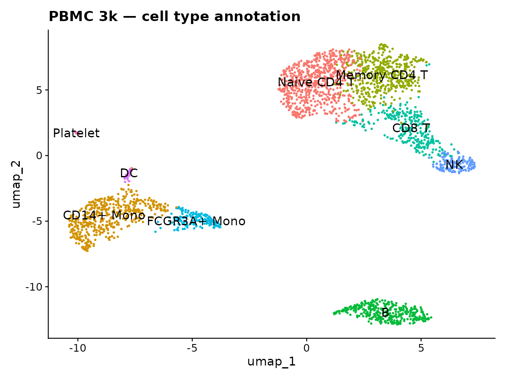
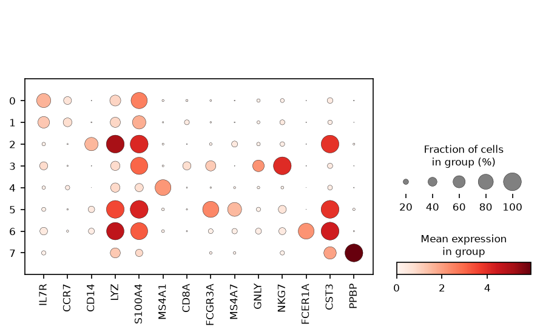
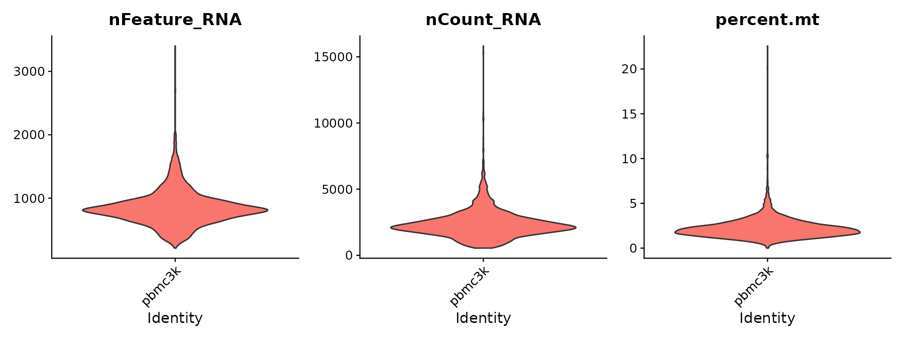
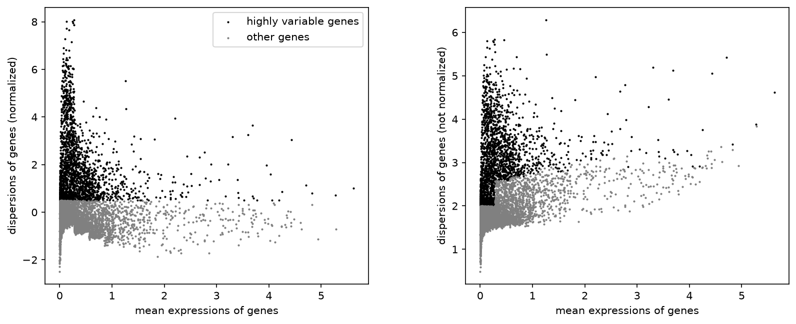

# 单细胞 RNA-seq 分析（Seurat + Scanpy）—— PBMC 3k 入门练习（2026-08）

我从 10x Genomics 的公开 count matrix 出发，用 **R/Seurat 和 Python/Scanpy 两套独立实现**，
各自走完 **质控 → 归一化 → 降维 → 聚类 → marker 基因 → 细胞类型注释** 全流程，
最后逐项对账，产出一套可复现的脚本、结果表和图。

**和 DNA-seq 项目（D01）的区别**：单细胞分析**不需要跑比对**。CellRanger 已经把 reads 比对、
计数成「基因 × 细胞」的矩阵，分析从矩阵开始。所以这套练习在笔记本上几分钟就能跑完，也不需要服务器。

## 结果速览

同一份数据，R/Seurat 与 Python/Scanpy 两套独立实现，各自产出：

| 细胞类型注释（R / Seurat） | 经典 marker 点图（Python / Scanpy） |
|---|---|
|  |  |

| QC 三大核心指标（R / Seurat） | 高变基因（Python / Scanpy） |
|---|---|
|  |  |

---

## 1. 数据（已核实）

| 项目 | 值 |
|---|---|
| 来源 | 10x Genomics 公开数据集 |
| 样本 | 外周血单个核细胞（PBMC），健康供体 |
| 细胞数 | **2,700** 个单细胞（QC 过滤后 **2,638**，见第 4.1 节） |
| 测序平台 | Illumina NextSeq 500 |
| 下载地址 | `https://cf.10xgenomics.com/samples/cell/pbmc3k/pbmc3k_filtered_gene_bc_matrices.tar.gz` |
| 格式 | CellRanger 输出的 `matrix.mtx` + `barcodes.tsv` + `genes.tsv`（压缩包只有几 MB） |

**为什么选这个数据集**：它是 Seurat 官方入门教程（[Guided Clustering Tutorial](https://satijalab.org/seurat/articles/pbmc3k_tutorial)）
使用的数据，**每一步都有公开的期望值可以对照**——细胞数、基因数、cluster 数、
每个 cluster 的细胞类型，官方教程全部给出来了。

选它的另一个原因是**结果可以被逐项核对**，而不只是产出一张图。
第 4 节记录了对账的方式和结果。

---

## 2. 环境准备

工具链在 Linux 下运行（WSL 的 Ubuntu 即可）：

```bash
# ① 进入 WSL（Windows 终端里执行）
wsl -d Ubuntu

# ② 建环境（在项目目录下）
cd ./bioinformatics-practices/scRNAseq/01-pbmc3k     # 换成自己的实际路径

# R / Seurat 版
conda env create -f envs/scrna.yaml
conda activate scrna

# Python / Scanpy 版（两个环境互相独立，都需要建）
conda env create -f envs/scanpy.yaml
conda activate scanpy
```

`envs/scrna.yaml` 从 conda-forge 装**预编译**的 Seurat，不用本地编译，
比 `install.packages("Seurat")` 快得多（后者在 Linux 上要编译几十个依赖，动辄一小时）。

> **版本说明**：conda-forge 上的 Seurat 通常比 CRAN 落后一些版本（官方教程用的是 5.5.0）。
> 对结果没有影响——实际运行确认，conda-forge 版本在 PBMC 3k 上的对账结果与官方教程一致
> （细胞数、基因数、cluster 数全部对上）。换更新的 Seurat 的做法是：只装 `r-base`，
> 再用 Posit 的 Linux 二进制仓库装 R 包。
>
> ⚠️ **两个 yaml 都没有固定版本号**（如 `scanpy`、`r-seurat` 只写包名，Python 是 `>=3.10`）。
> 所以**照这两份 yaml 装出来的版本，和本文档记录的实测版本可能不同**（第 4.1 节列的是
> 我这次运行的实际环境，仅作参照）。若对账结果出现偏差，第一件事是核对版本。

**资源预算**

| 项目 | 需求 |
|---|---|
| 磁盘 | 约 1 GB（数据几 MB，R 环境几百 MB，结果图十几 MB） |
| 内存 | 2 GB 足够（2700 个细胞，矩阵 13714 × 2700，稀疏存储约 30 MB） |
| 时间 | 建环境 20–40 分钟 / 每套（一次性）；跑流程 5–15 分钟 / 每套 |

---

## 3. 流程

**同一套分析有两份实现**——`scripts/*.R`（Seurat）和 `scripts/*.py`（Scanpy），
编号一一对应，跑的是同一份数据、同一套阈值、同一套参数。
两边都跑一遍，第 5 步会把结果逐项对比。两份独立实现的价值就在这里：
**逻辑错误很难同时在两边出现。**

### R / Seurat 版

```bash
conda activate scrna
bash scripts/run_all.sh
```

### Python / Scanpy 版

```bash
conda activate scanpy
bash scripts/run_all_py.sh
```

### 或者一步步来，每步都能单独看输出

> 以下命令需先 `conda activate scrna`（R 部分）或 `conda activate scanpy`（Python 部分），
> 否则 `Rscript` / `python` 找不到 Seurat / Scanpy。

```bash
bash scripts/01_download.sh        # 下载并解压 10x count matrix（两边共用）

# R（Seurat）
Rscript scripts/02_qc.R            # QC 指标 + 过滤低质量细胞
Rscript scripts/03_cluster.R       # 归一化 → 高变基因 → PCA → 聚类 → UMAP
Rscript scripts/04_markers.R       # marker 基因 + 细胞类型注释
Rscript scripts/05_verify.R        # 和历史结果对账

# Python（Scanpy）—— 同样的四步
python scripts/02_qc.py
python scripts/03_cluster.py
python scripts/04_markers.py
python scripts/05_verify.py
```

### 每一步在做什么

| 步骤 | 做什么 | 脚本（R / Python） | 产出 |
|---|---|---|---|
| 1 下载 | 取 CellRanger 输出的 count matrix | `01_download.sh`（两边共用） | `data/filtered_gene_bc_matrices/hg19/` |
| 2 质控 | 算 `nFeature_RNA` / `nCount_RNA` / `percent.mt`，过滤掉空液滴和濒死细胞 | `02_qc.R` / `02_qc.py` | `qc_summary.csv`、QC 图 |
| 3 降维聚类 | 归一化 → 找高变基因 → 标准化 → PCA → KNN 图 → Louvain / Leiden 聚类 → UMAP | `03_cluster.R` / `03_cluster.py` | `cluster_sizes.csv`、UMAP 图 |
| 4 marker | 每个 cluster 对比其余细胞做差异表达，再用经典 marker 注释细胞类型 | `04_markers.R` / `04_markers.py` | `cluster_markers.csv`、`pbmc3k_final.*` |
| 5 对账 | 和官方教程、以及另一语言版的结果逐项比对 | `05_verify.R` / `05_verify.py` | `verify_vs_tutorial.csv` |

所有产出都在 `results/R/`（Seurat）或 `results/python/`（Scanpy）下，两边一一对应；
个别图的文件名略有差异（R 侧把两张 QC 散点图合成一张，Python 侧分开输出），见第 5 节。

### 五个容易误解的关键点

**① 为什么要归一化？**
每个细胞测到的 UMI 总数差很多（几百到上万）。直接比 count，比的是"测得多深"而不是
"表达得多高"。`LogNormalize` 把每个细胞的总量拉到同一尺度（乘 10000 再取 log）。

**② 为什么要挑高变基因？**
单细胞数据里大部分基因在所有细胞里表达都差不多（管家基因 + 技术噪声）。
下游只用细胞间**变异大**的 2000 个基因，信噪比高得多。这不是"丢掉信息"，
是在已知噪声模型下做的特征选择。

**③ PC 数怎么选？**
看肘部图（`results/R/figures/04_elbow.png` 或 `results/python/figures/04_elbow.png`）——
方差解释率的拐点。这套数据拐点在 PC9-10，官方教程取 10。
**宁可取大不要取小**：教程明确说只取 5 个 PC 会显著破坏结果。
另外可以把 `results/*/pca_variance.csv` 里的累计方差当参考。

**④ resolution 是什么？**
Louvain 聚类的粒度参数。越大 cluster 越多、越细。3K 细胞常用 0.4–1.2。
改成别的值重跑：`RES=0.8 Rscript scripts/03_cluster.R`。**没有唯一正确答案**——
它取决于把什么程度的差异当成"一种细胞"。

**⑤ UMAP 上的距离能当结论吗？**
**不能。** UMAP 保留的是局部结构，两个 cluster 在图上离得远近没有定量意义。
UMAP 只用来看"分不分得开"，不能用来说"A 比 B 更像 C"。
官方教程专门写了这句：*avoid drawing biological conclusions solely on the basis of visualization techniques*。

---

## 4. 结果自检

`05_verify.R` / `05_verify.py` 会自动做三件事对账。

### 4.1 数值对账（对官方教程）

期望值来自 Seurat 官方教程（2026-04-28 编译版，Seurat 5.5.0 / R 4.5.2）。
**这一列只适用于 R 侧**——Python 版没有官方期望值，见下方说明。

| 指标 | 期望值（Seurat 教程） | 本项目实测（R / Python） |
|---|---|---|
| 建对象后细胞数 | 2,700 | 2,700 / 2,700 |
| 建对象后基因数 | 13,714 | 13,714 / 13,714 |
| QC 过滤后细胞数 | **2,638** | **2,638 / 2,638** ✅ |
| 中位 nFeature_RNA（过滤后） | 教程未单列 | 819 / 819 ✅ |
| 中位 nCount_RNA（过滤后） | 教程未单列 | 2,213 / 2,213 ✅ |
| 中位 percent.mt（过滤后） | 教程未单列 | 2.01 / 2.01 ✅ |
| cluster 数（`dims=1:10, resolution=0.5`） | **9** | **9**（Louvain）/ **8**（Leiden） |

表中实测值都可以从仓库里核对：细胞数/基因数/中位值在 `results/*/qc_summary.csv`，
cluster 数在 `results/*/cluster_sizes.csv`，两份文件可直接 `diff` 比对。

细胞数和基因数**精确一致**；cluster 数允许差 ±1 —— R 版用 Louvain 拿到 9，
Python 版用 Leiden 拿到 8，两者都在预期范围内。
**Python 的 8 不是"没达到期望"**，而是 Leiden 的正常结果，详见 4.2。

### 实测环境

| 组件 | 版本 |
|---|---|
| Python | 3.14.8 |
| scanpy | 1.12.4 |
| anndata | 0.13.4 |

> **这是本机那次运行的实际版本**，而 `envs/scanpy.yaml` **没有固定版本号**，
> 所以别人装出来的版本大概率不同（见第 2 节的版本提示）。

R 侧版本（R / Seurat / SeuratObject）由 `05_verify.R` 末尾自动打印。
**本次运行没有留存那份输出**，因此这里不给具体数字——重跑一次 `05_verify.R` 即可看到。

### 4.2 双语言交叉验证（Seurat vs Scanpy）

这是这个项目最有价值的一步。R 版和 Python 版是**两套完全独立的实现**：
不同语言、不同库、不同的默认参数。如果两边的细胞数、基因数、中位 QC 指标
逐项对得上（**cluster 数允许差 1–2 个**，原因见下），就说明**读数据、算指标、过滤这三个环节的逻辑是对的**——
一个逻辑错误要在两套独立实现里同时出现，概率极低。

> **本项目实测只出现了 cluster 数差 1 个**：细胞数 2,638 / 2,638、基因数 13,714 / 13,714、
> 三个中位 QC 指标全部逐位相同。下表是**常见**差异的排查参考，不是本项目的实测差异。

| 对不上的指标 | 常见原因 |
|---|---|
| 细胞数差几个 | 过滤顺序（先筛细胞还是先筛基因）、浮点比较的边界 |
| 基因数差几个 | 同上；`var_names_make_unique()` 的处理方式不同 |
| cluster 数差 1–2 个 | Seurat 默认 **Louvain**，Scanpy 默认 **Leiden**；邻居数默认值也不同（20 vs 15） |
| marker 排序不同 | Wilcoxon 检验的实现与近似方式不同 |

> **一个刻意的选择**：`03_cluster.py` 把 `n_neighbors` 显式设成 20，是为了对齐 Seurat 的 `k.param=20`；
> 但聚类算法（Louvain vs Leiden）**保持各自默认**——这不是没对齐，是不该硬凑。
> 两种算法本就给出不同粒度的社区，强行调到数字一致反而掩盖了真实差异。
> 这也是"两套结果为什么不一样"的正确解释方式。

> **这份对比是运行时打印的，没有落盘**：`05_verify.py` 会读取 `results/R/qc_summary.csv`
> 与 `cluster_sizes.csv`，在屏幕上逐项列出两边的数值和是否一致。
> 仓库里保留的 `verify_vs_tutorial.csv` 是**各自与教程**的对账表。
> 要看跨语言对比，得等 R 版跑完，再执行 `python scripts/05_verify.py` 才会触发。

### 4.3 生物学对账（更重要）

数值对账只说明参数对了。更本质的检查是：**已知的细胞类型 marker 有没有被找回来？**

脚本会检查 T 细胞（CD3D/CD3E/IL7R）、B 细胞（MS4A1/CD79A）、NK（NKG7/GNLY）、
单核（LYZ/CD14）、血小板（PPBP）这些公认 marker 是否出现在 `cluster_markers.csv` 里。

**实测结果：10 个 marker 全部找回，R 和 Python 两边完全一致**（`results/*/verify_marker_recovery.csv`）：

| 细胞类型 | marker | R | Python |
|---|---|---|---|
| T 细胞 | CD3D, CD3E, IL7R | 3/3 | 3/3 |
| B 细胞 | MS4A1, CD79A | 2/2 | 2/2 |
| NK 细胞 | NKG7, GNLY | 2/2 | 2/2 |
| 单核细胞 | LYZ, CD14 | 2/2 | 2/2 |
| 血小板 | PPBP | 1/1 | 1/1 |

**这一项不依赖 cluster 编号**——就算 cluster 0 和教程的 cluster 3 对应的是同一种细胞，
它也照样通过。它证明的是：**流程捞回的是数据集里真实存在的生物学信号，
而不是被参数选择决定的假象。**

### 4.4 官方教程给出的细胞类型对照表

| Cluster | 标记基因 | 细胞类型 |
|---|---|---|
| 0 | IL7R, CCR7 | Naive CD4+ T |
| 1 | CD14, LYZ | CD14+ Mono |
| 2 | IL7R, S100A4 | Memory CD4+ |
| 3 | MS4A1 | B |
| 4 | CD8A | CD8+ T |
| 5 | FCGR3A, MS4A7 | FCGR3A+ Mono |
| 6 | GNLY, NKG7 | NK |
| 7 | FCER1A, CST3 | DC |
| 8 | PPBP | Platelet |

**cluster 编号不是稳定契约。** 换了分辨率、换了 Seurat 版本，编号可能整体错位。
所以 `04_markers.R` 里先检查 cluster 数是否等于 9，不等于 9 就只打印提示、不硬套注释——
这样比"强行套上去然后结论全错"要好。

> **这张表只对应 R/Seurat 的编号。** Python 版用 Leiden 得到 8 个 cluster，
> 编号与 R 侧**不直接对应**；Python 侧的细胞类型判断依赖 4.3 的 marker 检查，
> 而不是这张表的编号。

---

## 5. 仓库结构

```
01-pbmc3k/
├── README.md                      # 本文件
├── .gitignore                     # 排除 data/、*.rds、*.h5ad
├── envs/
│   ├── scrna.yaml                 # R + Seurat 环境
│   └── scanpy.yaml                # Python + Scanpy 环境
├── scripts/
│   ├── 01_download.sh             # 下载 10x count matrix（两边共用）
│   ├── 02_qc.R         02_qc.py           # 质控与过滤
│   ├── 03_cluster.R    03_cluster.py      # 降维与聚类
│   ├── 04_markers.R    04_markers.py      # marker 与细胞类型注释
│   ├── 05_verify.R     05_verify.py       # 对账（教程 + 另一语言版）
│   ├── run_all.sh                 # 一键跑完（R）
│   └── run_all_py.sh              # 一键跑完（Python）
├── data/                          # 下载的数据（.gitignore 排除）
└── results/
    ├── R/                         # Seurat 的全部产出
    │   ├── *.csv                  # QC 汇总、cluster 大小、marker 表、对账表
    │   ├── *.rds                  # Seurat 对象（.gitignore 排除，体积大）
    │   └── figures/               # 全部结果图（★ 这些要提交）
    └── python/                    # Scanpy 的全部产出（与 R 侧一一对应）
        ├── *.csv
        ├── *.h5ad                 # AnnData 对象（.gitignore 排除）
        └── figures/
```

**同名同号的 `.R` 和 `.py` 是同一件事的两种实现**——这份对称本身就是文档：
读代码的人一眼能看出哪一步对应哪一步。唯一例外是 QC 阶段的图：
R 侧把两张散点图合成一张（`02_qc_scatter.png`），Python 侧分开输出（`02a` / `02b` / `02c`）。

**提交到 GitHub 时应包含**：`scripts/`、`envs/`、`README.md`、`.gitignore`，
以及 `results/*/*.csv` 和 `results/*/figures/*.png`。

> ⚠️ `results/*/*.csv` 里**不含跨语言对比表**——那份对比只在运行时打印、不落盘（见 4.2）。
> 仓库里的 `verify_vs_tutorial.csv` 是各自与教程的对账表。

**不入库**：`data/`、`results/R/*.rds`、`results/python/*.h5ad`（对象文件动辄几百 MB），
以及 `results/python/cluster_markers_all.csv`（未过滤的全量 marker 表，约 11 MB；
交付物是过滤后的 `cluster_markers.csv`）。

---

## 6. 时间投入

| 阶段 | 耗时 | 说明 |
|---|---|---|
| 建 conda 环境 | **20–40 分钟 / 每套** | 一次性；R 和 Python 两套都要建，**合计 40–80 分钟** |
| 下载数据 | 几秒 | 压缩包只有几 MB |
| 跑完整流程 | 5–15 分钟 | 主要耗时在 `FindAllMarkers` |
| 对照官方教程核对结果 | 30 分钟 | 关键步骤 |
| 写 README + 整理结果图 | 1–2 小时 | 别人理解这个项目的第一入口 |

---

## 7. 这套流程的边界与已知取舍

- **没有做双细胞（doublet）检测**。生产流程会用 DoubletFinder / scDblFinder 先去掉
  两个细胞被同一个液滴包住的假细胞。本项目未包含这一步。
- **没有做批次校正**。这套数据只有一批，不存在批次效应。
  多样本整合要用 Harmony / CCA / RPCA，是另一套流程。
- **注释靠人工 + 经典 marker**，没有用自动注释（SingleR、CellTypist）。
  自动注释在有参考数据集时更快，但**结果仍需人工核对**。
- **只用了 `filtered` 矩阵**，没有走 CellRanger 从 fastq 到 count 的过程。
  真实项目里这一步由测序公司或运维完成。
- **归一化用的是 LogNormalize**，不是 SCTransform。
  SCTransform 在细胞数很大时更稳，也是主流做法之一，暂未纳入本项目。
- **没有做轨迹推断、细胞通讯、CNV 推断**——那些是下游分析，各有专门工具。

---

## 8. 常见问题

**Q：为什么不用从 fastq 开始？**
单细胞比对和定量由 CellRanger 完成（它要处理 barcode、UMI、比对、去重、计数），
不是自己写脚本能替代的。真实项目里的分析，通常也是从 count matrix 开始的，
所以这套练习的入口和实际工作一致。

**Q：跑出来的 cluster 编号和教程不一样，是我错了吗？**
不一定。cluster 编号只是 Louvain 输出的顺序，**本身没有含义**。
判断对错要看：cluster 数是否接近 9、每个 cluster 的 top marker 是不是教程表里对应的基因。

**Q：cluster 数不是 9 怎么办？**
做法是先跑 `05_verify.R` / `05_verify.py` 看 marker 找回情况。如果 marker 都能找回，说明流程是通的，
差异来自版本或参数（Python 版用 Leiden，**实测为 8 个**）。调数量的入口是环境变量 `RES`：
`RES=0.6 Rscript scripts/03_cluster.R` 或 `RES=0.6 python scripts/03_cluster.py`。

**Q：`FindAllMarkers` 很慢？**
它默认对每个 cluster 做一次全基因组的 Wilcoxon 检验。2700 个细胞通常 1–5 分钟。
细胞数上万时通常改用 `presto`，Seurat 会自动调用它，速度快一个数量级。

**Q：怎么改分辨率或 PC 数？**
`NPCS=15 RES=0.8 Rscript scripts/03_cluster.R`，两个参数都是从环境变量读的。

---

## 9. 再往下可以扩展什么

**已完成**：用 Scanpy 复现同一套分析。R/Seurat 与 Python/Scanpy 是两套独立实现，
`05_verify.py` 会逐项对账（见第 4.2 节）——这一步本身就是本项目的主体。

下面按性价比排序，都是这套数据上还能直接做的：

1. **SingleR / CellTypist 自动注释**，和自己的人工注释对账（交叉验证思路）
2. **DoubletFinder** 做双细胞检测，看有多少细胞被判为 doublet
3. **换一套多样本数据**（如 IFN-β 刺激 vs 对照，Kang et al. 2018），
   加 Harmony 整合 + 组间差异表达 + 通路富集——这一步才真正产出"生物学结论"
4. **换一种归一化方法**（SCTransform）再比一次，用同样的对账框架验证
